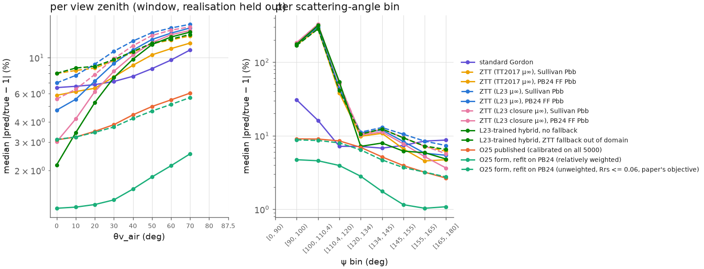
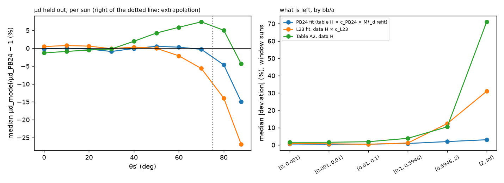
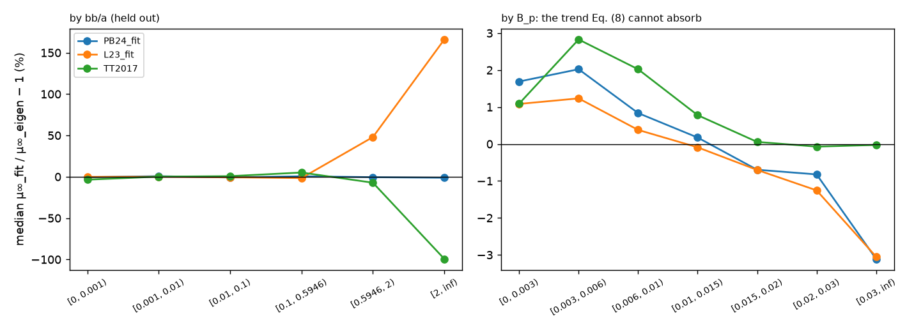
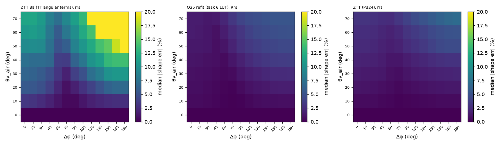
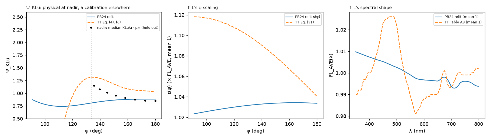
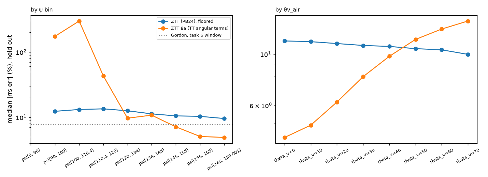

# Fitting ZTT to PB24 — interim report (M8, after tasks 8a and 8b)

**Version:** 1.0
**Date:** 2026-11-18
**Authors:** J. Xavier Prochaska and Claude (tasks 1–6: Opus 5.5; tasks 7,
8a, 8b and this note: Fable 5.1)
**Status:** interim. Tasks 1–7, 8a and 8b of milestone M8 are done; 8c (the
ladder and the acceptance gate) and 8d (closing M8) have not run. The
joint Ψ_KLu/f_L refit of 8b fails most of its predictions, and the
question of which form 8c should carry (Q33 of
[`rt_fit_pb24.md`](../../claude_prompts/RT/rt_fit_pb24.md)) is **open**.
Every number here is copied from the generated files beside this one
(`baseline_report.md`, `fit_metrics.md`, `angular_metrics.md`) and the
figures are the committed ones, not regenerated.

**Code:** `robust/rt/ztt.py` (`rrs_ZTT(variant="pb24")`),
`design/py/run_pb24_baseline.py`, `design/py/fit_ztt_pb24.py`,
`design/py/fit_ztt_pb24_angular.py`, branch `fit-pb24`; record
[§7c](../rt_elastic_implementation.md) of the implementation record.

---

## 1. Summary

- **The question.** Can the ZTT analytic reflectance model (Twardowski &
  Tonizzo 2018; Zaneveld's structure with the backward volume scattering
  function explicit) be recalibrated on the Pitarch & Brando 2024
  HydroLight ensemble (PB24) so that it beats the standard Gordon model
  across PB24's full viewing geometry, while staying finite everywhere and
  holding its L23 performance? That is the acceptance rule written before
  the fits (Q27, Q29): window held-out median error below Gordon's 7.84%
  **and** non-physical values under 1%, with L23 held-out rRMS within
  0.5 pp of 2.90%.
- **Before any refit** (task 6), every ZTT variant is worse than Gordon in
  the sanctioned window (θs, θv_air ≤ 70°): 8.70–10.42% median against
  7.84%, with 5–9% of its values non-physical (≤ 0 or non-finite). The
  error is in the geometry: ZTT is best of all models at nadir (4.7%) and
  worst at θv_air = 70° (15.3%). O25's lookup-table form, refit on the same
  training rows, reads 1.51%.
- **The IOP-side terms are now solved** (task 8a). PB24's own diffuse
  fraction as a shipped table, a refit sun-angle correction and refit M*_d
  put µd within 0.4–1.0% of PB24's at every sun in the window and within
  3% out to bb/a > 2; Eq. (8)'s form refit to the asymptotic µ∞ of PB24's
  own IOPs is 1.10% from it, with the ±2–3% B_p trend the form cannot
  carry left on record.
- **The angular terms are the problem, and the refit as specified does not
  fix it** (task 8b). Refitting Ψ_KLu(ψ) and f_L(ψ, λ) jointly, linearly in
  closure space, repairs what TT's pair gets wrong — the BRDF shape
  (0.4–3.8% per view zenith against 1.6–12.9%), the poles (0% non-physical
  against 5.9%), the tails (q90 24% against 88%) — but the **level is
  worse: 10.86% median against 8.96% before the refit and Gordon's 7.84%.**
  A function of ψ alone is exhausted (3–7 polynomial terms give the same
  residual), because the nadir sun trend and the off-nadir view shape pull
  it in opposite directions, and because the clear-water level needs an
  IOP dependence that the chosen form (Q24: Ψ_KLu IOP-independent, as TT
  wrote it) excludes.
- **Measured but not shipped**: the same linear fit with Ψ_KLu's basis
  widened by (1, X, L) products reaches 6.76%, below Gordon; adding a
  cos θs_w modifier reaches 5.83% with the shape error at 1.8%. Both are
  one more run of the same script. Which, if either, to ship is Q33, not
  yet answered; 8c waits on it.

## 2. The data and the set-up

**PB24** (Pitarch & Brando 2025; `context/RT/pitarch2025a.pdf`): 5,000
HydroLight realisations with Fournier–Forand phase functions
(B_p 0.0014–0.043), 451 bands at 350–800 nm, 1,300 geometries each
(10 sun zeniths × 10 view zeniths × 13 relative azimuths), elastic only
(`no_R`). Each file carries the IOP components, `rrs` at the in-water view
angle and `Rrs` at the air angle, the surface AOPs (`mu_d`, `KLu`, …) and
`Esdir_Es_ratio`, the above-surface direct-to-total irradiance ratio whose
complement is the diffuse fraction H that ZTT's µd needs. There are no
depth profiles, so the asymptotic µ∞ is available only from the
eigenproblem on PB24's IOPs (task 6) or from closure.

**Conventions** (tasks 3–4). A sample is an above-water geometry:
`Geometry.theta_s` and `theta_v` are the air zeniths, refracted by Snell
(n = 1.34) inside the model; ψ is the in-water scattering angle between the
refracted sun direction and the in-water view direction, so nadir viewing
has ψ = 180° − θs_w and the window's minimum ψ is 90.9°. Gordon, ZTT and the
hybrid are scored in `rrs`; O25 in `Rrs`. The **window** is θs ≤ 70° and
θv_air ≤ 70° (832 geometries per realisation); the **shell** (either angle
≥ 80°) is reported but never fitted.

**Fits and scores.** Every fit is deterministic linear least squares (no
optimiser) on the training side of a saved realisation split
(4,000 / 1,000; `splits.json`, digest `3dd4bc…`), and every number quoted
is held out unless marked. The error is `e = pred/true − 1` per value
(sample × band); medians and q90 are over all values from a fixed
histogram of log10|e| (±0.23% resolution), rRMS and counts are exact
float64 sums, and non-physical predictions stay in the median and are
counted, never dropped. Every script has a `--check` that reruns the fit
and compares every output byte for byte.

## 3. The model

### 3.1 ZTT, Equation (12)

Subsurface remote-sensing reflectance, with θv_w the in-water view zenith
from nadir (the paper measures it from straight down, so its −cos θv is our
+cos θv_w):

$$
r_{rs}(\lambda,\theta_s,\theta_v,\Delta\phi) \;=\;
\frac{1}{\mu_d}\,\frac{\beta(\psi)/b_b}
{\underbrace{\dfrac{a}{b_b}\Big(1 + \cos\theta_{v,w}\,\dfrac{\Psi_{KLu}(\psi)}{\mu_\infty}\Big)
 + f_L(\psi,\lambda)\Big(1-\dfrac{1}{\tilde b_b}\Big) + \dfrac{1}{\tilde b_b}}_{D}}
\tag{12}
$$

Its pieces, each with the paper's equation number:

$$
\frac{\beta(\psi)}{b_b} = \frac{P_{bb}(\psi)\,b_{bp} + \beta_w(\psi)}{b_{bp}+b_{bw}},
\qquad
\tilde b_b = \frac{b_{bp}+b_{bw}}{b_{bp}/\tilde b_{bp} + 2 b_{bw}},
\tag{10, 11}
$$

$$
\Psi_{KLu}(\psi) = \frac{K_{Lu}}{K_\infty} = 1 + F(\psi),
\qquad
f_L(\psi,\lambda) = f_{L,\mathrm{ave}}(\lambda)\,s(\psi),
\tag{4, 6, 31}
$$

$$
\mu_d = M^+_d(\theta_s',H)\;c(\theta_s')\;M^*_d(X,L),
\qquad
M^+_d = \frac{P_3(\cos\theta_s')}{(1-H)/\cos\theta_{s,w} + H/0.859},
\tag{14, 15}
$$

$$
M^*_d = (m_1L+m_2)X^3 + (m_3L+m_4)X^2 + (m_5L+m_6)X + m_7L + m_8,
\qquad
\mu_\infty = \sum_{k=0}^{3}\Big(\sum_{j=0}^{3} m_{kj}L^j\Big)X^k,
\tag{17, 8}
$$

with X = log10(bb/a), L = log10 η_bb, η_bb = bbw/(bbp + bbw), P_bb(ψ) the
particulate backward phase function (sr⁻¹) and b̃bp = B_p the particulate
backscattering ratio. The numerator is exact for PB24: `P_bb_from_phase`
evaluates PB24's own two-component Fournier–Forand pair. c(θs′) = 1 +
c₁u + c₂u², u = 1 − cos θs′, is M7's sun-angle correction to M⁺_d.

### 3.2 What "ZTT (PB24)" replaces, term by term

| term | TT 2018 (`"tt2017"`) | M7 (`"l23"`, package default) | **M8 (`"pb24"`)** |
|---|---|---|---|
| P_bb(ψ) | Sullivan & Twardowski constant shape | FF pair from `PhaseParams` | FF pair, as `"l23"` |
| H(θs′) | Eq. (16), V = 15 km, spectrally flat | same | **10 × 451 table of 1 − `Esdir_Es_ratio`**, linear in sec θs′ and λ (8a) |
| c(θs′), M*_d | none; Table A2 | L23 refit | **refit to PB24's `mu_d`, window suns, bb/a to 17** (8a) |
| µ∞ | TT2017 Table 1 (Eq. (8)'s coefficients are not published) | Eq. (8) refit to L23 profiles | **Eq. (8) refit to the eigen µ∞ of PB24's IOPs, no B_p term** (8a, Q22) |
| Ψ_KLu(ψ) | quartic in ψ-degrees, Eqs (3)–(4) | same | **1 + F(ψ), F a quintic in u = 1 + cos ψ, refit through rrs** (8b, Q24, Q30) |
| f_L(ψ, λ) | Table A3 shape × (1.0405 + 0.0776 sin ψ) | same | **FL_AVE(λ) per band × (s₀ + s₁ sin ψ + s₂ cos ψ)** (8b, Q25) |
| floor on D | none | none | **one-sided softplus, D → D + w ln(1 + e^{(D₀−D)/w}), (D₀, w) = (0.5, 0.01)** (8b) |

`"l23"` and `"tt2017"` are bit-identical to what they were; the new variant
is additive, with `angular_model` and `floor` switches so 8c's ladder can
toggle each term.

### 3.3 The joint refit in closure space (8b)

Given µd, µ∞ and the exact P_bb, Eq. (12) inverts to a closure target per
(sample, λ) from PB24's own rrs,

$$
D^\ast = \frac{\beta(\psi)/b_b}{\mu_d\; r_{rs}^{PB24}},
$$

and the two unknown angular terms enter D linearly:

$$
D^\ast - \frac{a}{b_b}\Big(1+\frac{\cos\theta_{v,w}}{\mu_\infty}\Big) - \frac{1}{\tilde b_b}
\;=\;
\underbrace{\frac{a}{b_b}\frac{\cos\theta_{v,w}}{\mu_\infty}}_{g_F}\;F(\psi)
\;-\;\underbrace{\Big(\frac{1}{\tilde b_b}-1\Big)}_{g_L}\;f_{L,\mathrm{ave}}(\lambda)\,s(\psi).
$$

With F a polynomial in cos ψ and f_L the product of a per-band shape and
s(ψ), the problem is linear in (F, s) at fixed FL_AVE and linear in
(F, FL_AVE) at fixed s: two alternating linear passes, a fixed twelve
rounds, rows weighted 1/D* (relative weighting in D, which is relative
weighting in rrs to first order). One streamed pass over the training
window (1.50 × 10⁹ rows) accumulates the block normal equations — the
sufficient statistics of every linear fit in that column space — so the
passes, the order test and the residuals run in memory, and a rerun is
byte-identical. Off-nadir, the refit Ψ_KLu is a calibration of Eq. (12)'s
BRDF shape through rrs; it is a physical K_Lu/K_∞ only at nadir, where PB24
measures `KLu`.

## 4. The analysis so far

1. **Tasks 1–5: the data in hand.** An `ocpy` reader for the hyperspectral
   and OLCI files; consolidation caches (`pb24_v1`, memory-mapped, 36 GB)
   with a committed miniature fixture so the suite runs without the data;
   the loader in above-water geometry; the conventions (refraction, the
   Fresnel `Rrs`→`rrs` transfer, the per-sample diffuse-fraction seam);
   the O25 model of Pitarch et al. 2025 reproduced and scored, and refit
   on our training rows as the yardstick.
2. **Task 6: the baseline.** Every elastic model in `robust.rt` scored on
   the full ensemble (`baseline_report.md`, 11 CSVs, 5 figures): Gordon,
   six ZTT (µ∞, P_bb) combinations, the L23-trained hybrid, O25 published
   and refit; every cut and breakdown; the diagnostics of §5.1.
3. **Task 7: the design discussion** (Q21–Q31, no code). What task 6 says
   term by term, with options, predictions and recommendations; JXP's
   decisions fixed the plan: PB24's H and a refit µd (Q21), Eq. (8) refit
   alone with no B_p term (Q22), D1 and D2 then the joint refit (Q23),
   **Ψ_KLu IOP-independent as TT wrote it (Q24)**, FL_AVE per band (Q25),
   the ZTT arm alone with the O25-form backbone deferred to its own prompt
   doc (Q26), the decision rule (Q27), no emulator retrain in M8 (Q28),
   the gate (Q29), F(ψ) in cos ψ (Q30), `"pb24"` the default on a pass
   (Q31).
4. **Task 8a: H, µd, µ∞** (`fit_ztt_pb24.py`, streamed Householder QR).
5. **Task 8b: D1, D2, the joint refit and the floor**
   (`fit_ztt_pb24_angular.py`).
6. **Not yet run.** 8c: the ladder through the baseline runner (each term
   added alone and removed alone, the D2 ceiling and the oracle rung
   beside), the L23 check, and the pass/fail of the gate. 8d: notebook,
   review pass, record and reports, hand-off.

## 5. Results

### 5.1 The baseline (task 6)

Window, realisation split held out, 350–800 nm, 3.75 × 10⁸ values per
row. Gordon, ZTT and the hybrid in `rrs`, O25 in `Rrs`.

| model | median % | q90 % | non-physical % |
|---|---|---|---|
| O25 form, refit on PB24 (relatively weighted) | **1.51** | 5.6 | 0 |
| O25 published (in sample) | 4.08 | 18.1 | 0 |
| L23-trained hybrid, no fallback (350–750 nm) | 7.31 | 111 | 5.5 |
| standard Gordon | 7.84 | 21.0 | 0 |
| ZTT (TT2017 µ∞), PB24 FF P_bb | 8.70 | 75 | 5.2 |
| ZTT (L23 closure µ∞), PB24 FF P_bb | 9.17 | 182 | 9.4 |
| ZTT (L23 µ∞), PB24 FF P_bb — package default | 10.33 | 119 | 6.9 |
| ZTT (TT2017 µ∞), Sullivan P_bb — the M5 model | 10.42 | 73 | 5.2 |



*Figure 1 (task 6). Median error per above-water view zenith (left) and per
in-water scattering-angle bin (right), window, held out. Every model
degrades with θv_air, ZTT fastest (4.7% at nadir, 15.3% at 70°, against
6.5% and 11.2% for Gordon, which has no view-angle term); below
ψ = 110.4°, where TT's Ψ_KLu changes sign, ZTT is off by 100–300%.*

What task 6 established, each as a prediction with its outcome in
`baseline_report.md`:

- The explicit phase function is worth a steady 1–1.7 pp (Sullivan → FF at
  every µ∞); ZTT's structure holds at nadir and the error is in its
  ψ-dependent terms.
- PB24's own H halves µd's sun trend (18 → 9 pp over 0–70°) rather than
  removing it; the rest is M⁺_d's form and M*_d's extrapolation beyond
  bb/a = 0.1.
- At nadir ZTT's Ψ_KLu/µ∞ is 19–21% above PB24's measured K_Lu/a, with a
  16–84% spread of 1.03–1.68 where TT assume < 2% IOP dependence; the
  oracle K_Lu/a worsens rrs (7.0 → 9.2%) because f_L is calibrated against
  the wrong Ψ_KLu.
- The asymptotic µ∞ varies 6.2% with B_p at fixed (bb/a, η_bb); Eq. (8)'s
  form cannot absorb it.
- Eq. (12) has a second pole besides ψ < 110.4°: with f_L > 1 the last two
  terms of D are negative, so D crosses zero above a finite bb/a that
  scales with b̃b/(f_L − 1). It explains the non-physical values inside
  ZTT's own ψ domain and the 10⁵–10⁶% rRMS. No bounded correction repairs
  a pole, hence the floor.

### 5.2 The IOP-side terms (task 8a)

**H.** `Esdir_Es_ratio` is bit-identical across all 5,000 realisations, so
1 − it is a 10 × 451 table, shipped as `files/diffuse_fraction_pb24.npz`
and served linearly in the air mass sec θs′ and in λ. The variable was
chosen by measurement: leaving each interior node out, sec θs′ reproduces
H to 0.1–3.1% at 10–60° where cos θs′ gives 0.1–6.9%; the real spacing is
half the leave-one-out spacing, and the consequence for M⁺_d at double
spacing is at most 0.24% through 60° and 1.6% at 70°.

**µd.** M*_d's eight coefficients and c(θs′) refit jointly against PB24's
`mu_d` on the window suns (14.4 M rows) with the table H inside M⁺_d:
seven free nodes first, then the quadratic fitted to them (its node
residuals reach 0.85% at 30°, the form's limit, Q32: kept). Held out,
median |deviation| per sun 0.51 / 0.50 / 0.50 / 0.96 / 0.41 / 0.63 / 0.52 /
0.71% at 0–70°; by bb/a 0.42–0.83% below 0.59, 1.93% at 0.59–2 and 2.99%
above 2, where the L23 fit with the same H reads 12% and 31%. The 80° and
87.75° nodes, extrapolated, are −4.6% and −14.9%: the rough-surface regime
the form does not describe.



*Figure 2 (task 8a). µd against PB24's `mu_d`, held out: per sun (left;
right of the dotted line is extrapolation) and what remains by bb/a
(right). The PB24 fit is flat at ≤ 1% through 70° and holds to bb/a > 2.*

**µ∞.** Eq. (8)'s sixteen coefficients refit to the task-6 eigen product
(the asymptotic µ∞ of each (realisation, λ) with PB24's own FF pair),
relative residuals, the (X, L) box widened to PB24's range (bb/a 6e-5 to
17, η_bb 9e-6 to 1), no B_p term (Q22). Held out: 1.10% median overall
(the L23 fit 0.90% in the bulk but +48% beyond its clamp; TT2017 1.78%),
2.68% at bb/a > 2, and the B_p trend the form cannot carry: +1.7% at
B_p < 0.003 to −3.1% above 0.03.



*Figure 3 (task 8a). The µ∞ variants against the eigen µ∞, held out: by
bb/a (left) and by B_p (right). The PB24 fit holds over PB24's whole range;
the B_p trend is common to every Eq. (8) form.*

### 5.3 The angular terms (task 8b)

**D1, the BRDF-shape test.** rrs(θv, Δφ)/rrs(nadir) at fixed (realisation,
θs, λ), model against PB24, separates the angular shape from the nadir
level. Median |shape error| in %, pooled over Δφ, held out:

| θv_air | 10° | 20° | 30° | 40° | 50° | 60° | 70° |
|---|---|---|---|---|---|---|---|
| ZTT, TT's angular terms (the 8a variant) | 1.63 | 3.26 | 5.60 | 7.66 | 10.20 | 11.87 | 12.86 |
| O25 refit (task 6 LUT), in Rrs | 0.45 | 0.76 | 1.13 | 1.61 | 2.11 | 2.43 | 2.80 |
| **ZTT (PB24), the joint refit** | 0.41 | 0.84 | 1.32 | 1.81 | 2.55 | 2.92 | 3.79 |



*Figure 4 (task 8b). The shape error per (θv_air, Δφ) node, held out, for
the three models of the table (colour scale capped at 20%). TT's pair is
worst toward Δφ = 180° at high θv (129% at 70°, 165–180°, where ψ is
smallest and Ψ_KLu changes sign), not toward Δφ = 0 as predicted; the
refit is below 7% at every node.*

**D2, the nadir ceiling.** Ψ_KLu/µ∞ replaced by PB24's measured K_Lu/a and
a per-band f_L(λ) refit, nadir only, linear: **2.84%** median held out
(2.74% with PB24's own µd), q90 13%. Against the 4% criterion, Eq. (12)'s
structure is sound at nadir once its two calibrated terms are right; the
prediction of ≤ 2.5% was missed narrowly.

**The joint refit.** Five terms in u = 1 + cos ψ for F (TT's order, fixed
before the fit; the order test shows 3–7 terms give 15.5% D-space rRMS
alike); s = (1.0190, 0.0042, −0.0147) against TT's (1.0405, 0.0776, 0);
FL_AVE(λ) within 0.9929–1.0098 against Table A3's 0.981–1.026. The floor
moves 0.35% of held-out window values by more than 1e-4 (the model's
minimum unfloored D is −0.75; PB24's own D* is ≥ 1.096 on every training
value).



*Figure 5 (task 8b). The refit terms against TT's. Left: Ψ_KLu(ψ); the
dots are PB24's nadir K_Lu/a · µ∞ per sun (held out), the one physical
check, which the refit meets at 0–20° and falls below from 30° on. Middle:
f_L's ψ scaling, flat at 1.02–1.03 where TT's runs 1.04–1.12. Right: the
spectral shape, now smooth and within ±1%.*

Held out, window, in rrs:

| model | median % | q90 % | rRMS % | non-physical % |
|---|---|---|---|---|
| ZTT (L23 µ∞), FF — package default (task 6) | 10.33 | 119 | 1.5e5 | 6.86 |
| ZTT, 8a variant (PB24 H/µd/µ∞, TT's Ψ_KLu and f_L) | 8.96 | 88 | 2.5e5 | 5.87 |
| **ZTT (PB24), 8b, floored** | **10.86** | **24.3** | **21.3** | **0.00** |
| ZTT (PB24), 8b, no floor | 10.86 | 24.3 | 6.0e4 | 0.08 |
| standard Gordon (task 6) | 7.84 | 21.0 | 12.95 | 0 |



*Figure 6 (task 8b). Median rrs error held out, by ψ bin (left) and by
above-water view zenith (right), for the refit and the 8a variant, with
Gordon's window median dotted. The refit removes the ψ < 110° catastrophe
and the growth with θv, but sits at 10–13% everywhere where TT's pair
reads 4–5% near nadir and at large ψ.*

Where the level goes, median % held out:

| by θs | 0° | 10° | 20° | 30° | 40° | 50° | 60° | 70° |
|---|---|---|---|---|---|---|---|---|
| ZTT (PB24) | 7.73 | 8.05 | 9.26 | 10.96 | 12.60 | 14.21 | 16.10 | 18.72 |
| 8a variant | 9.79 | 9.36 | 7.98 | 7.27 | 7.58 | 8.71 | 10.04 | 12.44 |
| Gordon | 6.67 | 6.97 | 7.21 | 7.46 | 7.85 | 8.36 | 9.09 | 9.94 |

| by bb/a | < 0.001 | 0.001–0.01 | 0.01–0.1 | 0.1–0.59 | 0.59–2 | ≥ 2 |
|---|---|---|---|---|---|---|
| ZTT (PB24) | 15.03 | 13.03 | 7.41 | 11.33 | 14.75 | 149 |
| 8a variant | 5.13 | 5.32 | 9.68 | 11.96 | 155 | 171 |

| by ψ | 90–100° | 100–110.4° | 110.4–120° | 120–134° | 134–145° | 145–155° | 155–165° | 165–180° |
|---|---|---|---|---|---|---|---|---|
| ZTT (PB24) | 12.36 | 13.18 | 13.49 | 12.59 | 11.30 | 10.52 | 10.35 | 9.59 |
| 8a variant | 174 | 299 | 43.1 | 9.70 | 10.79 | 7.16 | 5.10 | 4.91 |

**Predictions and outcomes** (written in the task text before the run):

| prediction | outcome |
|---|---|
| D1: ZTT's shape error > 5% at θv_air ≥ 40°, largest toward Δφ = 0; O25's < 2% everywhere | **Half confirmed**: 7.7% at 40° (already 5.6% at 30°); largest toward Δφ = 180°; O25 2.1–2.8% pooled at θv ≥ 50° |
| D2: ≤ 2.5% median at nadir | **Not confirmed, narrowly**: 2.84%; below the 4% structural criterion |
| Joint refit: window median 4–6% | **Not confirmed**: 10.86% |
| non-physical < 1% of values | **Confirmed**: 0% floored, 0.08% unfloored |
| ψ ≥ 155° ≤ 3%; ψ 110.4–134° < 10% | **Not confirmed**: 9.88% and 12.84% |
| Ψ_KLu monotone in ψ, within [0.8, 2.5] | **Not confirmed**: 0.742–0.885 with a minimum near 113° |
| nadir Ψ_KLu/µ∞ within 5% of K_Lu/a | **Not confirmed**: 16.3% median; the ratio runs 1.04 at θs = 0° to 0.71 at 70° (TT's pair: 1.20 at every sun) |
| floor footprint < 1% | **Confirmed**: 0.35% |

### 5.4 Why the refit as specified fails

- **F(ψ) is exhausted.** Three to seven polynomial terms leave the same
  15.5% residual in D-space: more freedom along ψ buys nothing.
- **Two trends pull one function in opposite directions.** At nadir the
  truth K_Lu/a · µ∞ rises with the sun (0.85 at θs = 0° to 1.15 at 70°;
  TT's quartic follows that at a constant 1.20×). Off-nadir, the view
  shape wants Ψ_KLu to fall toward small ψ. The fit, dominated by the 103
  off-nadir geometries per sun, follows the shape, so the nadir ratio drops
  from 1.04 to 0.71 across the suns and the error by θs grows from 7.7% to
  18.7% (table above).
- **The clear-water level needs an IOP dependence the form lacks.** For
  bb/a ≪ 1, D ≈ (a/bb)(1 + cos θv_w Ψ_KLu/µ∞) and only Ψ_KLu/µ∞ matters;
  at nadir and fixed θs its 16–84% spread is 0.89–1.44. Ψ(ψ)/µ∞(X, L)
  has no lever on that, and f_L (multiplying 1 − 1/b̃b) has no bb/a lever
  at all. The result is 13–15% at bb/a < 0.01, where TT's pair happens to
  read 5%.
- **The structure itself is not the limit at nadir**: D2's 2.84% says that
  with the right Ψ_KLu/µ∞ and f_L, Eq. (12) is a 3% model there.

### 5.5 Measured, not shipped

A scratch copy of the 8b script with wider columns in the same linear fit
(same statistics, solver, floor and scoring; one 15-minute pass; held out,
window, floored). X = log10 bb/a, L = log10 η_bb clamped to the 8a box;
each row multiplies the quintic in cos ψ by the listed modifiers.

| Ψ_KLu = 1 + F, F = | columns | median | q90 | ψ ≥ 155° | ψ 110.4–134° | θs 0° / 70° | D1 pooled, θv = 70° |
|---|---|---|---|---|---|---|---|
| F(ψ) — shipped, Q24 | 5 | 10.86 | 24.3 | 9.88 | 12.84 | 7.7 / 18.7 | 3.79 |
| F(ψ) · (1, X) | 10 | 7.97 | 21.4 | 7.14 | 8.74 | 7.0 / 13.5 | 4.31 |
| F(ψ) · (1, X, L) — task 7's recommendation | 15 | **6.76** | 17.7 | 5.83 | 7.63 | 5.1 / 13.3 | 4.23 |
| F(ψ) · (1, X, L, cos θs_w) | 20 | **5.83** | 14.7 | 5.02 | 6.74 | 5.0 / 8.0 | 1.75 |
| + X · cos θs_w | 25 | 5.69 | 14.6 | 4.93 | 6.58 | 5.2 / 6.8 | 1.63 |

Non-physical values are 0% in every row and the floor footprint ≤ 0.03%.
By bb/a, the (1, X, L) form reads 6.0 / 3.9 / 5.5 / 10.4 / 13.0 / 53%
across the six bins where the shipped form reads 15 / 13 / 7.4 / 11.3 /
14.8 / 149%. The 8a variant, for scale: 8.96 / 88 / 5.00 / 12.78 / 9.8 /
12.4 / 12.86.

## 6. Where this leaves the ZTT arm

**Against the acceptance rule.** The shipped "ZTT (PB24)" would fail 8c's
gate on the median (10.86% > 7.84%) while passing the non-physical clause
(0% < 1%); its L23 number is not yet measured. The (1, X, L) form would
pass the window clauses at 6.76%; the cos θs_w form at 5.83%; neither
reaches the 4–6% predicted for the design-(iii) form, nor O25's 1.51%.

**The open decision (Q33, unanswered).** (a) Run 8c on the shipped form:
the ladder attributes every term and the gate fails as recorded.
(b) Reverse Q24 to task 7's recommendation, Ψ_KLu = 1 + F(ψ)·(1, X, L):
beats Gordon, stays inside TT's premise that Ψ, like µ∞ and µd, is a
function of ψ and the IOPs. (c) (b) plus the cos θs_w modifier: the nadir
sun trend nearly flat and the shape at 1.8%, but Ψ_KLu is then no longer a
function of ψ alone, which was TT's reason for restating K_Lu in ψ.
(d) Stop the ZTT arm here and go to the O25-form backbone with the
explicit P_bb factor (Q26, its own prompt doc). Claude's recommendation is
(c), with (b) if Ψ_KLu is to be kept to ψ and the IOPs. Each of (b) and (c)
is one more run of the same script with the basis widened, a `F_psi_pb24`
that takes (X, L[, θs]) and new constants; 8c would then ladder that
variant.

**What is settled regardless.** The D-space machinery (closure target,
block normal equations, alternating passes, floor, `--check`) is built and
gated; the IOP-side terms of 8a stand on their own; and D2 fixes the
ceiling of Eq. (12) at nadir near 3%. Whichever form is chosen, the
emulator retrain (hand-off item, Q28) and the O25-form backbone (Q26)
remain the next milestones.

## 7. Files and reproducibility

| file | task | content |
|---|---|---|
| `baseline_report.md`, `baseline_*.csv`, `baseline_fig_*.png` | 6 | every model, cut and breakdown; diagnostics |
| `fit_coefficients.json`, `fit_metrics.{json,md}`, `fit_probes.json`, `fit_fig_mu_d.png`, `fit_fig_mu_inf.png` | 8a | H, µd, µ∞ fits; probes re-evaluated by the tests without the data |
| `angular_coefficients.json`, `angular_metrics.{json,md}`, `angular_probes.json`, `angular_fig_{terms,d1_shape,heldout}.png` | 8b | D1, D2, the joint refit, the floor |
| `robust/rt/files/diffuse_fraction_pb24.npz` | 8a | the shipped H table |
| `robust/tests/test_ztt_pb24.py` (25 items), `test_ztt_pb24_angular.py` (18) | 8a, 8b | constants == JSON; probes to 1e-12; closure round trip; normal equations == `lstsq`; gradients; `--check` on the miniature |

```bash
# conda ocean14, repo root; data: $OS_COLOR/SD/v5 and the pb24_v1 cache.
# Multi-worker runs from a plain terminal, in their own scope (M8 task 5c).
systemd-run --user --scope -p MemoryMax=80G python design/py/run_pb24_baseline.py   # ~1 h 45 min, 6 workers
python design/py/fit_ztt_pb24.py                                                      # 8a
systemd-run --user --scope -p MemoryMax=80G python design/py/fit_ztt_pb24_angular.py --workers 4   # 8b, ~15 min
python design/py/fit_ztt_pb24_angular.py --check --workers 4                          # byte-identical rerun
```

Suite after 8b: 908 passed, 5 skipped with the data; 828 passed, 85
skipped without. `ruff check` and `ruff format --check` clean.
