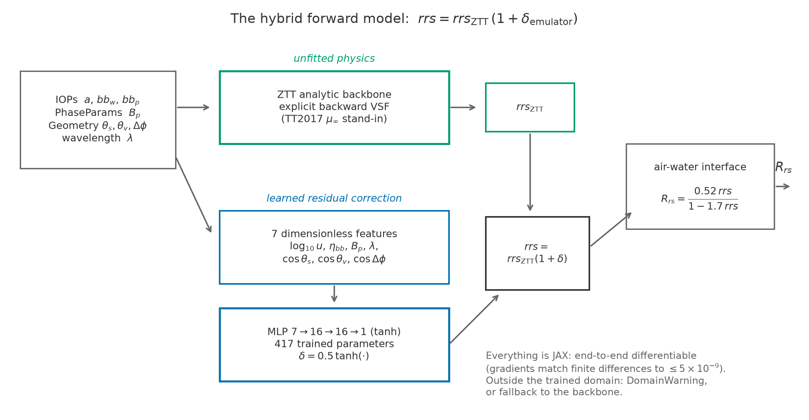
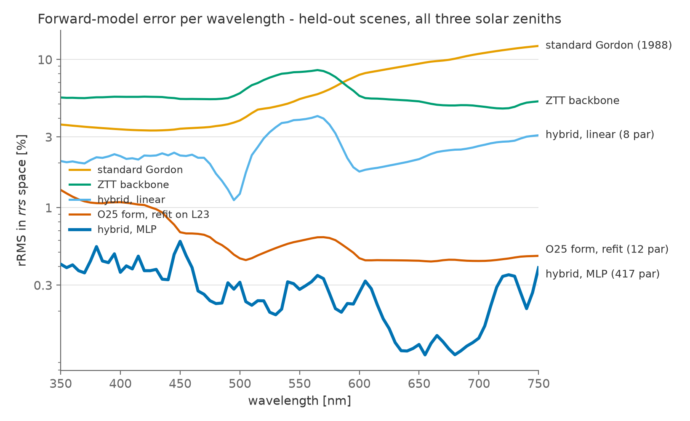
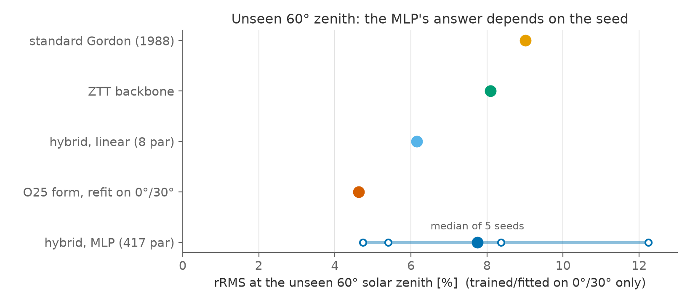

<!-- GENERATED FILE -- do not edit.
     Written by docs/figures/make_docs_figures.py from reports/report_rt_elastic_model.md.
     Edit that file instead; this copy is gitignored and is rewritten on every
     documentation build. The only differences from the source are this banner,
     image paths pointing into docs/_static/, and repo-relative links rewritten
     to absolute GitHub URLs. -->

# A differentiable elastic radiative-transfer forward model for ocean color

:::{note}
This page is a verbatim copy of [`reports/report_rt_elastic_model.md`](https://github.com/ocean-colour/retrieve-or-bust/blob/main/reports/report_rt_elastic_model.md), the team report as it was
written. Only the image paths and the repo-relative links differ; no wording,
number or section has been changed. It is reproduced here, rather than
summarised, because it is the evidence behind the rest of this site.
:::

**Version:** 1.2
**Date:** 2026-11-26 (1.1: 2026-10-31; 1.0: 2026-08-15)
**Authors:** J. Xavier Prochaska and Claude (Fable 5; M7 update: Opus 5.5; M8
update: Opus 5.5 and Fable 5.1/5.2)
**Status:** team report; intended to evolve into a public (non-refereed) write-up.

**Code:** the `robust.rt` subpackage of
[retrieve-or-bust](https://github.com/ocean-colour/retrieve-or-bust), branch
`rt-elastic-prototype` (milestones M0–M4); the M7 update (§9) on `more-elastic`;
the M8 update (§10) on `fit-pb24`.
**Figures:** generated by [`make_report_figures.py`](https://github.com/ocean-colour/retrieve-or-bust/blob/main/reports/make_report_figures.py) from the
committed validation artefacts in [`design/validation/`](https://github.com/ocean-colour/retrieve-or-bust/tree/main/design/validation);
the three PB24 figures of §10 are copies of committed figures in
[`design/ztt_pb24/`](https://github.com/ocean-colour/retrieve-or-bust/tree/main/design/ztt_pb24).

---

## Executive summary

We built a **differentiable forward model for elastic remote-sensing reflectance**,

> *rrs* = *rrs*<sub>ZTT</sub> · (1 + δ<sub>emulator</sub>),

an analytic radiative-transfer backbone with an explicit particle phase function
(Twardowski & Tonizzo 2018, "ZTT") plus a small learned residual correction (a
417-parameter MLP), implemented end-to-end in JAX. Trained and scored on the
Loisel et al. (2023) HydroLight ensemble (L23; 3,320 water bodies × 3 solar
zeniths × 81 wavelengths, elastic scattering only), the hybrid reaches

- **0.30% rRMS on held-out water bodies**, uniform across 350–750 nm and across
  the three solar zeniths (0°/30°/60°);
- **2.3× better than the modern semi-analytical benchmark** (the O25 bivariate
  form of Pitarch et al. 2025, refit on the same data: 0.69%), and 24× better
  than standard Gordon (1988);
- **exact gradients in every input** (`jax.grad` agrees with finite differences
  to ≤ 5×10⁻⁹), at ~5× the compute cost of the analytic backbone alone
  (~17 ms for the full 9,960 × 81 batch on CPU).

Held-out error equals training error to two decimals, so the gain is
generalization, not fit. The prototype passes its acceptance gate — beat the O25
benchmark on held-out scenes and pass the gradient gate — and the Week-1
milestone is complete.

The result comes with honest limits, stated in §5 before the number above should
be quoted anywhere: the margin over the state of the art is 2.3× (not 24×); O25's
own figure is its best case; **extrapolation to an unseen solar-zenith angle is
unresolved** (seed-dependent, 4.7–12.2%); phase-function generalization is
untested on L23's narrow range; and the sensor is nadir-only so the BRDF axes are
unexercised.

**Update 1.1 (M7, §9): the analytic backbone, refit to L23.** ZTT's Equation (8)
µ<sub>∞</sub> coefficients were never published. M7 computes µ<sub>∞</sub> from
L23's own IOPs (the asymptotic radiative-transfer eigenproblem), refits µ<sub>d</sub>
with a sky correction, and uses L23's own particle phase function. That halves the
backbone's held-out error, **5.93% → 2.90%** (60° sun: 8.11% → 3.18%), and the
refit, "ZTT (L23 µ<sub>∞</sub>)", is now the default backbone. **The hybrid and
its 0.30% are unchanged**: its emulator was trained on the TT2017 backbone and is
pinned to it until a retrain, which waits for PB24.

**Update 1.2 (M8, §10): the backbone taken to PB24; a nadir variant is the new
default.** PB24 (Pitarch & Brando 2025; 5,000 HydroLight realisations, 451
bands, 1,300 geometries each) varies what L23 holds fixed: the particle phase
function and the full viewing geometry. Off-nadir, ZTT does not survive it:
every ZTT variant is worse than Gordon over the 0–70° window (8.7–10.4% median
against 7.84%), and a full-geometry refit of its angular terms did not repair
it (10.86%). **At nadir it holds.** The new default backbone,
"ZTT (PB24_nadir)", is ZTT's sun and IOP terms refit to PB24 with Twardowski &
Tonizzo's own angular terms: **4.36% median** on held-out PB24 at nadir
(3.4% at a zenith sun, the geometry of BRDF-normalised satellite
*R*<sub>rs</sub>) against 6.52% for Gordon, with no non-physical value, and
3.39–3.64% rRMS on L23, which it never saw (the L23 refit: 2.90%). It is a
nadir model for *b*<sub>b</sub>/*a* ≤ 0.59 and it warns outside that. The
hybrid's 0.30% is again unchanged (its emulator stays pinned to TT2017).

## 1. Motivation and background

Retrieving inherent optical properties (IOPs) from ocean color is gated by the
forward model: any bias in the map from IOPs to *R*<sub>rs</sub> propagates
directly into the retrieved absorption and backscattering. The community-standard
Gordon (1988) approximation writes *rrs* as a polynomial in the single variable
*u* = *b*<sub>b</sub>/(*a* + *b*<sub>b</sub>) — but *rrs* is **not** univocal in
*u*. Water returns ~0.23 sr⁻¹ of its backscatter toward the sensor at 180° while
particles return ~0.12–0.16 sr⁻¹, so the water/particle composition of
*b*<sub>b</sub> matters independently of *u*; our earlier BING work found the
same fact empirically as wavelength-dependent Gordon coefficients with extra
offset (G0) and *b*<sub>bp</sub>-slope (Gb) terms. The full synthesis of that
lineage — Gordon → Park & Ruddick (2005) → Lee (2011)/O25 — is in
[`context/RT/rt_elastic_model.md`](https://github.com/ocean-colour/retrieve-or-bust/blob/main/context/RT/rt_elastic_model.md).

The deeper axis, emphasized by R. Frouin in his advisory comments, is the
**particle phase function**: almost every analytical model buries it in
coefficients or LUTs derived from RT runs with a *prescribed* phase function, so
none can represent independent variability in its shape — a first-order driver of
the angular distribution of water-leaving radiance. The exception is **ZTT**
(Twardowski & Tonizzo 2018), which carries the backward VSF explicitly. His
recommended architecture — a full-RT reference, a fast differentiable emulator,
and a hybrid with ZTT as the physically interpretable backbone — is what the
design document ([`design/rt_elastic_model.md`](https://github.com/ocean-colour/retrieve-or-bust/blob/main/design/rt_elastic_model.md))
adopted and this prototype implements. Scope is strictly **elastic** (no Raman,
no fluorescence), forward-model only, with the API kept inversion-ready.

## 2. The model



The public API is one call,
`robust.rt.forward(iops, phase_params, geometry, wave, mode)`, with three modes
(`ztt`, `emulator`, `hybrid`) sharing one signature. Everything on the forward
path is pure JAX: `jit`- and `vmap`-safe, and differentiable end-to-end.

**The analytic backbone** (`robust/rt/ztt.py`) is a transcription of the ZTT
forward relation, every function naming the equation it implements: the shape
factor Ψ<sub>KLu</sub>, the backward phase functions of water (derived
analytically from the Zhang et al. 2009 form; 0.234 sr⁻¹ at 180°) and particles
(the Sullivan & Twardowski 2009 measured average, with a corrected typo in their
published polynomial's *a₃* coefficient), the *f*<sub>L</sub> spectral factor,
and the downwelling-average cosine µ<sub>d</sub>. Two independent checks anchor
the transcription: the paper's own worked example (θ<sub>s</sub>′ = 60° → 40.3°
in-water, ψ = 139.7°) reproduces to 0.04°, and µ<sub>d</sub> reproduces the
paper's quoted 0.79–0.94 range. One term could not be transcribed: the 2018
paper's Equation (8) coefficients for µ<sub>∞</sub> are not published, so the
antecedent **Twardowski & Tonizzo (2017)** Table 1 stands in (§6). All results
here are therefore *"ZTT with the TT2017 µ<sub>∞</sub>"*. The phase function
enters explicitly through *B*<sub>p</sub> = *b*<sub>bp</sub>/*b*<sub>p</sub>, the
particulate backscattering ratio.

**The learned half** (`robust/rt/emulator.py`) is deliberately small and
bounded: a 7→16→16→1 tanh MLP (417 parameters) over seven dimensionless features
that provably capture the backbone's complete state (the backbone is
scale-invariant in the IOPs, verified to 9×10⁻¹⁵). It emits a **relative**
correction δ, bounded to ±0.5 by construction, with a zero-initialized output
layer so the untrained hybrid *is* the backbone and every reported gain is a
gain. It is pointwise in wavelength, so it is defined on any spectral grid. The
trained weights (6.5 kB) are committed, so `forward()` works out of the box.

**Guard rails.** The emulator carries its own training domain; evaluating a
learned mode outside it raises a `DomainWarning`, or, under
`on_out_of_domain="ztt"`, falls back to the pure backbone — a policy built on a
traceable mask so it survives `jit`.

## 3. Data and validation protocol

**Reference data.** The L23 elastic set: 3,320 water bodies × 81 wavelengths
(350–750 nm) at three solar zeniths (0°/30°/60°), nadir viewing, one fixed
Fournier–Forand phase function per scene (*B*<sub>p</sub> ∈ [0.0103, 0.0180]).
Pure water contributes the *majority* of total backscatter over much of the
spectrum (~72% at 400 nm for the median scene), which is the quantitative reason
the water/particle split is carried explicitly.

**Splits.** Two held-out sets, fixed and seeded: a random **20% of scenes**
(split by water body, never by sample, so the same IOPs cannot appear on both
sides at different sun angles), and **one solar zenith** (train on 0°/30°, test
on 60°).

**Metric.** rRMS in *rrs* space (the sub-surface quantity; the air–water
interface is non-linear, so relative error in *R*<sub>rs</sub> is not the same
number). One shared implementation scores every model.

**Fairness to the benchmark.** O25's published coefficients are not printed in
its paper, so its form was **refit on our training split with our metric as the
objective** — worth 4× to O25 versus the paper's unweighted least squares. Every
table therefore says "O25 form, refit on L23", and its numbers are its best case.
Standard Gordon (fixed 1988 coefficients) and the unfitted ZTT backbone complete
the ladder; PR05 is absent because its 4-D coefficient LUT is unpublished and
nadir-only L23 could not populate its sensor-geometry axes.

## 4. Results

rRMS (%) in *rrs* space, full 9,960-sample batch
([`design/validation/metrics.md`](https://github.com/ocean-colour/retrieve-or-bust/blob/main/design/validation/metrics.md)):

| model | train | held-out scenes | held-out @60° |
|---|---|---|---|
| standard Gordon (1988) | 7.21 | 7.21 | 9.01 |
| ZTT backbone alone | 5.95 | 5.93 | 8.11 |
| **O25 form, refit on L23** (12 fitted numbers) | 0.70 | **0.69** | 0.71 |
| hybrid, linear emulator (8 parameters) | 2.57 | 2.54 | 2.48 |
| **hybrid, MLP emulator** (417 parameters) | **0.30** | **0.30** | **0.32** |



Three features of the ladder are worth words. **The unfitted ZTT backbone already
beats Gordon overall** — flat at 4–6% where Gordon degrades toward the red
(12% at 750 nm) — which is the physics of an explicit VSF paying off before any
learning. **The gap that matters is to O25**, not to Gordon: the O25 bivariate
form, twelve fitted numbers with geometry-only coefficients, reaches 0.69% on
held-out scenes; the hybrid's margin over it is 2.3×. **The linear-emulator
baseline (2.54%) is the honest yardstick for the MLP**: the nonlinearity earns
~8×, not the ~20× a baseline-free comparison would suggest. Accuracy is uniform
where it should be: per solar zenith the hybrid reads 0.29/0.30/0.32% on held-out
scenes (the backbone alone degrades, 4.26 → 8.11%), and per *B*<sub>p</sub> bin
it is flat at 0.27–0.33%.

**The unseen-zenith split is the failure mode**, and it is reported rather than
gated:



Trained on 0°/30° only and asked for 60°, the MLP hybrid scores 4.74–12.24%
across five random seeds (median 7.75%): cos θ<sub>s</sub> spans [0.866, 1.0] in
that training set while 60° needs 0.5, so every tanh unit runs outside its fitted
range and the initialization decides the answer. The **refit O25 wins outright
there — 4.63%, deterministically** — and even the linear emulator (6.16%) beats
the MLP's median. At an unseen geometry, the benchmark beats us and is more
reproducible; this is the main open problem (§6).

**Speed** (jitted, CPU, full batch): Gordon 0.28 ms, O25 0.46 ms, ZTT backbone
3.76 ms, hybrid ~17 ms (4.5–6× the backbone across runs). The hybrid does not
collapse the analytic model's speed advantage over calling an RT solver.

**Gradients.** `jax.grad` versus central finite differences (float64,
per-variable steps), for *a*, *b*<sub>bp</sub>, *B*<sub>p</sub> and
θ<sub>s</sub>, every model: agreement ≤ 5×10⁻⁹. Two traps the protocol pins:
a model that genuinely ignores a variable (O25 has no phase-function input)
reports 0.0 = agreement, not infinity; and O25 is non-differentiable at its own
coefficient-table nodes, so gradients are certified at 45°, between nodes.

**Verification.** 279 tests pass (256 + 23 skips without the dataset — what CI
sees, on Python 3.12 and 3.14); the suite includes golden-value checks against
the raw L23 netCDF and the ZTT paper's worked example, the gradient gates, and
regression tests for every defect found in four review passes (PRs #9–#12 plus a
self-review). Five executed notebooks (`notebooks/RT/`) walk through each
milestone.

## 5. What the prototype may claim — and what it may not

**It may claim:** on held-out water bodies from the reference ensemble, a
differentiable elastic forward model with an explicit phase-function input that
reaches 0.30% rRMS, uniform across the spectrum and the three solar zeniths, with
machine-precision gradients, at ~5× the cost of its analytic backbone.

**It may not claim:**

1. **A 24× advance.** That is the margin over a 1988 model. Over the modern
   benchmark (O25) it is **2.3×**.
2. **Victory over O25 as published.** O25's 0.69% comes from coefficients refit
   on *our* training split with *our* objective; the published paper prints only
   plots. It is labeled "O25 form, refit on L23" everywhere for this reason.
3. **Geometry generalization.** At the unseen 60° the answer depends on the seed
   (4.7–12.2%) and the benchmark wins deterministically. The acceptance gate was
   deliberately written on the scene split.
4. **Phase-function generalization.** L23 spans a factor 1.7 in *B*<sub>p</sub>
   against the design's ~7× nominal band, with one fixed Fournier–Forand shape.
   Flat per-bin accuracy on that slice is not evidence of generalization.
5. **Any off-nadir capability.** L23 fixes the sensor at nadir and the azimuth at
   zero; the BRDF axes are untested, and the domain check correctly flags any
   off-nadir view.
6. **The published 2018 ZTT model.** Its Equation (8) µ<sub>∞</sub> coefficients
   are not in the paper; the TT2017 surface stands in. Results are "ZTT with the
   TT2017 µ<sub>∞</sub>". *(1.1: M7 adds "ZTT (L23 µ<sub>∞</sub>)", a refit of
   our own, §9. It is still not the authors' 2018 model.)*

## 6. Open items

For JXP to dispatch; none block the conclusions above.

1. **ZTT Equation (8) coefficients.** JXP has emailed the authors. When the
   sixteen *m* coefficients arrive, `mu_inf_coeffs=` restores the published 2018
   model in one line, and the backbone numbers should be regenerated.
   *(1.1: M7 refit them to L23 in the meantime, §9.)*
2. **Geometry extrapolation** (§5, item 3). The structural options — geometry-
   aware features or architecture, training data at more angles (PB24 or new
   HydroLight runs), or leaning on the deterministic analytic path off-grid — are
   M5 design decisions, not patches.
3. **M3 task 5** (the hand-off edit to `rt_elastic_coding_prompt_5.md`) was
   overtaken by M4 actually completing and can be closed as such.
4. **`rt_elastic_coding_prompt_6.md` (M5) is a deliberate placeholder**, to be
   detailed from this report's priorities (§7).
5. **Merge status.** The prototype lives on `rt-elastic-prototype` (PR #12);
   merging to `main`/`RT` is JXP's call, as is archiving
   [`design/prototype_summary.md`](https://github.com/ocean-colour/retrieve-or-bust/blob/main/design/prototype_summary.md) if this
   report supersedes it as the reviewer-facing summary.

## 7. Recommended priorities (M5)

In order of leverage, from the design's beyond-week-1 track plus what M4
actually taught us:

1. **Vary the phase function in the reference data.** New HydroLight runs with
   the particle phase-function shape explicitly varied (Frouin's central
   recommendation), with PB24 (5,000 IOPs × 1,300 geometries, the set O25 was
   calibrated on) in parallel for the geometry axes. This attacks the two
   untested axes — phase-function shape and BRDF — at once, and is the only way
   to make claims 4 and 5 of §5 testable.
2. **Retrieval impact.** The decisive metric for this project is not forward
   rRMS but component-retrieval error (*a*<sub>ph</sub>, *a*<sub>dg</sub>,
   *b*<sub>bp</sub> MAPE) through an inversion. The forward model is
   differentiable precisely so this study is cheap; it should come before more
   forward-model polish.
3. **Fix geometry extrapolation** with data (more angles) rather than
   architecture — M3's seed sweep showed architectural patches (a linear skip
   path) were initialization luck.
4. **Promote the phase function in the API**: add the ZTT backward-VSF
   descriptors (*P*<sub>bb</sub>(ψ) and shape terms) as optional
   `PhaseParams` fields — the design's planned generalization beyond the scalar
   *B*<sub>p</sub>, which changes no call sites.
5. **Close the ZTT transcription** with the Equation (8) coefficients when they
   arrive (§6, item 1).

## 8. Reproducibility

```bash
# environment: conda ocean14 (JAX CPU); data: $OS_COLOR/Loisel2023/
pytest -q                              # 279 tests at 1.0 (928 at 1.2); 85 skip without the data
python design/py/train_emulator.py    # ~1 min; see the note below
python design/py/run_validation.py    # ~8 min; regenerates design/validation/
python reports/make_report_figures.py # the four figures in this report
# M7 (§9):
python design/py/build_l23_profile_product.py  # L23 depth profiles -> µ∞/µd product
python design/py/fit_ztt_l23.py               # ~4 min first run (eigen µ∞, cached)
python design/py/run_ztt_l23.py               # the ladder + acceptance gate
# M8 (§10); data: $OS_COLOR/SD/v5 and the pb24_v1 cache (design/py/build_pb24_cache.py)
systemd-run --user --scope -p MemoryMax=80G python design/py/run_pb24_baseline.py  # ~1 h 45 min
python design/py/fit_ztt_pb24.py              # H, µd, µ∞ on PB24
python design/py/fit_ztt_pb24_nadir.py        # the nadir variant scored; ~2 min; --check
python reports/make_report_figures.py         # also copies the three PB24 figures
```

Every number in this report traces to `design/validation/metrics.{md,csv}` or to
pinned tests; CI runs the suite and lint on every branch.

*Correction (2026-10-31, M7).* An earlier version said the retrain gives
"bit-identical committed weights". It no longer does. Rerunning
`train_emulator.py` today writes a file that adds the M5 `envelope/*` keys,
and its weights differ from the committed `robust/rt/files/emulator_l23.npz`
by up to 0.02, presumably from the M5 save-format change and environment
drift. That is true of the code at the last pre-M7 commit as well. Every number
here is reproducible *from the committed weights file*, which is pinned by
SHA-256 in the test suite. The file will be regenerated and re-pinned when the
emulator is next retrained (`claude_prompts/RT/rt_fit_ztt.md`, Q18/Q19).

## 9. Update (M7): the ZTT backbone refit to L23

*Added 2026-10-31. Full record: [`design/rt_elastic_implementation.md`](https://github.com/ocean-colour/retrieve-or-bust/blob/main/design/rt_elastic_implementation.md)
§7b; decisions: [`claude_prompts/RT/rt_fit_ztt.md`](https://github.com/ocean-colour/retrieve-or-bust/blob/main/claude_prompts/RT/rt_fit_ztt.md);
artefacts: [`design/ztt_l23/`](https://github.com/ocean-colour/retrieve-or-bust/tree/main/design/ztt_l23); explainer:
`notebooks/RT/rt_fit_ztt_l23.ipynb`.*

**The gap it closes.** The 2018 paper's Equation (8) µ<sub>∞</sub> coefficients
were never published, so every number above uses the authors' 2017 surface.
M7 refits ZTT's µ<sub>∞</sub> to L23 instead. Measuring three of ZTT's terms
against L23 showed that µ<sub>d</sub> and the particle phase function mattered
too.

**What changed**, in three terms:

1. **µ<sub>∞</sub> is computed, not measured.** L23's depth profiles (to 50 m)
   reach the asymptotic regime on only 2.4% of (scene, λ), so µ<sub>∞</sub> comes
   from the asymptotic eigenproblem of the azimuthally averaged RTE on L23's own
   inputs: water plus two Fournier–Forand particle populations. The solver is
   exact against the analytic isotropic case. On the 2.4% where the profiles
   *do* measure µ<sub>∞</sub> it reads **+1.3% high** (±0.3%), a stated
   systematic. Equation (8) fitted to it: held-out median error 0.21%. The
   TT2017 surface it replaces errs by +8.6% at the 84th percentile and +24% at
   the 99th.
2. **µ<sub>d</sub> carried the 60° failure.** TT's atmospheric factor puts
   µ<sub>d</sub> **8.7% high at 60° sun** under L23's sky. A two-number
   correction c(θ<sub>s</sub>′), fitted jointly with M\*<sub>d</sub>, brings the
   held-out error to ≤ 0.5% at every zenith.
3. **L23's own phase function**, the two Fournier–Forand components (HydroLight's
   Mobley 2002 convention, an assumption L23 does not state), replaces
   Sullivan & Twardowski's average shape.

**Result** (held-out scenes, rRMS in *rrs*):


| backbone | 0° | 30° | 60° | all |
|---|---|---|---|---|
| ZTT (TT2017 µ<sub>∞</sub>) — §4 | 4.26 | 4.67 | 8.11 | 5.93 |
| **ZTT (L23 µ<sub>∞</sub>)** — the default from 1.1 until 1.2 (§10) | **2.91** | **2.56** | **3.18** | **2.90** |
| closure µ<sub>∞</sub> — a ceiling, not physics | 1.20 | 1.43 | 1.47 | 1.37 |
| O25 form, refit on L23 — for reference | 0.68 | 0.69 | 0.71 | 0.69 |

The acceptance gate was "beats ZTT (TT2017 µ<sub>∞</sub>) at every zenith". It
passes. The old backbone's signature zenith over-prediction, rrs(60°)/rrs(0°) =
0.85 against L23's 0.95, is largely gone (0.94). `variant="tt2017"` reproduces
the old backbone bit for bit.

**Two findings that set the limits.**

- **ZTT's terms are fitted together, so fixing one can break another.** ZTT's
  near-surface Ψ<sub>KLu</sub> is ~13% higher than L23's measured K<sub>Lu</sub>/a.
  Substituting the measurement makes the backbone *worse*: 7.8–9.5% at any
  sampling depth. TT's other fitted terms (f<sub>L</sub> above all) are tuned
  to their Ψ<sub>KLu</sub>.
- **The closure µ<sub>∞</sub>** is the value that makes ZTT reproduce each L23
  spectrum exactly. It shows µ<sub>∞</sub> could buy about half the remaining
  error, but only as an empirical knob that absorbs every other term's error.
  It ships as an option (`mu_inf_model="l23_closure"`), never as the default.

**What it may claim, and what not.** It may claim a physically fitted analytic
backbone that halves its held-out error on L23 and removes the 60° failure.
It may not claim:
- the authors' 2018 model;
- µ<sub>∞</sub> to better than the +1.3% eigen-vs-HydroLight offset;
- anything off-nadir, or at sun angles other than L23's three (the sky
  correction is exactly determined by them);
- that the backbone competes with O25 refit (0.69%) or the hybrid (0.30%).

**What it does not change.** The hybrid's numbers (§4) are unchanged: the
emulator records the backbone it was trained on ("tt2017") and `forward` honours
that record. Until the emulator is retrained, `forward(mode="ztt")` (the L23
backbone) and `forward(mode="hybrid")` (TT2017 + δ) use different backbones.

**Next** (JXP, Q20 answer (a)): L23 is done. The effort moves to PB24, which has
ten sun angles to test c(θ<sub>s</sub>′) and off-nadir geometries where ZTT's
Ψ<sub>KLu</sub> is known to fail (M5). After that, retrain the emulator on
whichever backbone survives.

## 10. Update (M8): the backbone taken to PB24, and a nadir variant as the default

*Added 2026-11-26. Full record: [`design/rt_elastic_implementation.md`](https://github.com/ocean-colour/retrieve-or-bust/blob/main/design/rt_elastic_implementation.md)
§7c; decisions: [`claude_prompts/RT/rt_fit_pb24.md`](https://github.com/ocean-colour/retrieve-or-bust/blob/main/claude_prompts/RT/rt_fit_pb24.md)
(Q1–Q45); artefacts: [`design/ztt_pb24/`](https://github.com/ocean-colour/retrieve-or-bust/tree/main/design/ztt_pb24), of which
[`report_ztt_pb24_interim.md`](https://github.com/ocean-colour/retrieve-or-bust/blob/main/design/ztt_pb24/report_ztt_pb24_interim.md)
is the full-geometry story and
[`nadir_metrics.md`](https://github.com/ocean-colour/retrieve-or-bust/blob/main/design/ztt_pb24/nadir_metrics.md) the nadir one;
the all-model baseline is [`report_pb24_baseline.md`](https://github.com/ocean-colour/retrieve-or-bust/blob/main/reports/report_pb24_baseline.md).*

**Why PB24.** L23 is nadir-only, has three sun angles and a narrow range of
particle phase functions. PB24 (Pitarch & Brando 2025) is 5,000 HydroLight
realisations with Fournier–Forand phase functions whose backscattering ratio
B<sub>p</sub> spans 0.0014–0.043 (L23: 0.010–0.018), 451 bands at 350–800 nm,
and 1,300 geometries each (10 sun zeniths × 10 view zeniths × 13 azimuths).
It is elastic only, has no depth profiles, and tabulates the surface AOPs
(µ<sub>d</sub>, nadir K<sub>Lu</sub>) and the sky's diffuse fraction. Every
fit below is deterministic linear least squares on the 4,000 training
realisations of a saved split and scored on the other 1,000; errors are
relative, per value (sample × band), and non-physical predictions stay in
every median and are counted.

**Off-nadir, ZTT does not survive PB24** (the 0–70° window in both zeniths,
held out, 3.75 × 10⁸ values):

| model | median % | q90 % | non-physical % |
|---|---|---|---|
| O25 form, refit on PB24 (in *R*<sub>rs</sub>) | 1.51 | 5.6 | 0 |
| O25 as published (in sample) | 4.08 | 18.1 | 0 |
| standard Gordon | 7.84 | 21.0 | 0 |
| ZTT (TT2017 µ<sub>∞</sub>), PB24's FF phase function | 8.70 | 75 | 5.2 |
| ZTT (L23 µ<sub>∞</sub>) — the 1.1 default | 10.33 | 119 | 6.9 |
| ZTT (PB24): every term refit, full geometry | 10.86 | 24.3 | 0 |


*Median error per above-water view zenith (left) and per in-water scattering
angle ψ (right), window, held out. ZTT is the best model at nadir and the
worst at 70°; below ψ = 110.4°, where Twardowski & Tonizzo's Ψ<sub>KLu</sub>
changes sign, it is off by 100–300%.*

The failure is in ZTT's two angular terms, Ψ<sub>KLu</sub>(ψ) and
f<sub>L</sub>(ψ, λ), which the paper fitted for ψ ≥ 134°. Refitting them
jointly through PB24's *rrs* fixes the BRDF *shape* (0.4–3.8% per view zenith
against 1.6–12.9%) and removes every non-physical value, but the *level* gets
worse (10.86% against 8.96% before the refit), because one function of ψ
cannot carry both the nadir sun trend and the off-nadir view shape. That
variant ships opt-in (`variant="pb24"`) as the record. The off-nadir problem
is handed to the O25 form, which reads 1.51% on the same rows.

**What did transfer: the sun and IOP terms** (they are part of the new
default):

- **The diffuse fraction H.** PB24's own sky (RADTRAN-X, 40 km visibility) is
  identical in all 5,000 files, so it ships as a 10 × 451 table,
  `diffuse_fraction_pb24`, the default H of the PB24 variants; a per-sample H
  (`Geometry.diffuse_fraction`) overrides it.
- **µ<sub>d</sub>.** The sun-angle correction and M\*<sub>d</sub> refit to
  PB24's µ<sub>d</sub>: 0.4–1.0% at every sun from 0° to 70°, and within 3% out
  to *b*<sub>b</sub>/*a* > 2 (the L23 fit: 12–31% there).
- **µ<sub>∞</sub>.** Equation (8) refit to the asymptotic eigen-solution on
  PB24's own IOPs and phase functions: 1.10% over *b*<sub>b</sub>/*a* from
  6 × 10⁻⁵ to 17, with a ±2–3% trend in B<sub>p</sub> that the form cannot
  carry left on record.

**Nadir: the measured K<sub>Lu</sub> does not help.** At nadir each ZTT term
has its own PB24 observable, so we fitted Ψ<sub>KLu</sub>(ψ) to PB24's
measured nadir K<sub>Lu</sub> and f<sub>L</sub> by closure, keeping
Twardowski & Tonizzo's IOP-independent form. It reads **11.00%**, worse than
what it replaces, and 11.8% on L23. The reason is measured: K<sub>Lu</sub>/K<sub>∞</sub>
is not IOP-independent. At a zenith sun it falls from 1.00 in the clearest
water (TT's Ψ<sub>KLu</sub>(180°) is 1.02) to 0.5 at *b*<sub>b</sub>/*a* > 0.6,
so a single function fitted to all of it is 20% low exactly where the
K<sub>Lu</sub> term is half of Equation (12)'s denominator. Giving
K<sub>Lu</sub> an IOP dependence reads 3.5–4.8% on PB24 but 5.9–8.1% on L23:
no K<sub>Lu</sub> calibrated on PB24 transfers. The fit is kept as a record
(`angular_model="pb24_klu"`). This repeats, with ten suns and a wide IOP
range, what M7 saw on L23 (§9): ZTT's terms are tuned to each other.

**The new default: "ZTT (PB24_nadir)".** The M7 pattern on PB24: PB24's H,
µ<sub>d</sub> and µ<sub>∞</sub>, the Fournier–Forand phase function, **TT's
own Ψ<sub>KLu</sub> and f<sub>L</sub>**, and a smooth floor on Equation (12)'s
denominator so the model is finite everywhere. It is
`rrs_ZTT(variant="pb24_nadir")` and, by decision (Q45), `rrs_ZTT`'s default,
so `forward(mode="ztt")` now evaluates it. Held out, nadir view, suns 0–70°,
all 451 bands (3.6 × 10⁶ values):

| model | median % | q90 % | non-physical % | θ<sub>s</sub> = 0° | 30° | 60° |
|---|---|---|---|---|---|---|
| standard Gordon | 6.52 | 17.5 | 0 | 7.57 | 6.93 | 5.62 |
| ZTT (L23 µ<sub>∞</sub>) — the 1.1 default | 4.73 | 34.7 | 2.55 | 3.71 | 3.19 | 4.72 |
| **ZTT (PB24_nadir)** — the default | **4.36** | 21.2 | **0** | **3.42** | **3.12** | 6.11 |
| Ψ<sub>KLu</sub> fitted to the measured K<sub>Lu</sub> (a record) | 11.00 | 18.1 | 0 | 12.09 | 11.61 | 9.28 |
| ceiling: the measured K<sub>Lu</sub>/*a* itself, f<sub>L</sub> per band | 2.84 | 13.0 | 0.004 | 3.27 | 3.07 | 2.05 |


*Median nadir error per sun. The default is within 0.2 pp of the ceiling for
suns up to 30° and loses to Gordon from 60°; 80° and 87.75° were never
fitted.*


*The same error by* b<sub>b</sub>/a *and by the particle backscattering ratio.
The default is a clear-water model: 1.4% and 2.1% below* b<sub>b</sub>/a *=
0.01 (Gordon: 7.5% and 10.7%), level with Gordon at 0.01–0.1, behind it at
0.1–0.59 (8.4% against 3.3%), and wrong beyond 0.59. It is flat in
B<sub>p</sub> over the 30-fold range PB24 provides.*

- **Its domain is stated and enforced by a warning.** Nadir viewing and
  *b*<sub>b</sub>/*a* ≤ 0.59 (95.4% of PB24's nadir values; 4.03% median
  there). Above that Equation (12) with f<sub>L</sub> > 1 nears a pole: 67% at
  0.59–2 and 228% beyond, where Gordon reads 16% and 20%. The floor keeps the
  value finite, not right. A concrete off-nadir view angle or
  *b*<sub>b</sub>/*a* above the limit raises a `DomainWarning`.
- **In *R*<sub>rs</sub>** (through the two-number Fresnel transfer fitted in
  M8, with the sample's diffuse fraction): 4.91% median, and 4.42% at a
  zenith sun against Gordon's 7.37%. The transfer alone is 1.5% at nadir, and
  its denominator makes 0.08% of the *R*<sub>rs</sub> values non-physical
  (all at high *b*<sub>b</sub>/*a*).
- **On L23, never used in the fit** (held-out scenes, rRMS): 3.64% as called
  by default (PB24's sky table) and 3.39% with TT's sky, against 2.90% for
  the L23 refit of §9, which was fitted there, and 5.93% for the 1.0 backbone.
- **The acceptance rule, stated plainly.** Written before the fit: nadir
  median below 4.0%, non-physical below 1%, L23 within 0.5 pp of 2.90%. The
  variant passes the last two and **misses the first (4.36%)**. It is the
  default by decision, not by the gate: it is the best nadir number we have
  that also holds on L23, tested across a 30-fold range of B<sub>p</sub> (L23:
  under two-fold) and at eight sun angles (L23: three).

**What it may claim, and what not.** It may claim an analytic backbone,
calibrated on two independent HydroLight ensembles, that beats Gordon at
nadir in clear to moderately turbid water and is finite everywhere. It may
not claim:
- anything off-nadir (use the O25 form there);
- turbid water (*b*<sub>b</sub>/*a* > 0.59), or sun zeniths beyond 70°;
- inelastic effects: PB24 here is Raman-free, and satellite
  *R*<sub>rs</sub> is not;
- that it is better than the L23 refit on L23 (it is 0.5–0.7 pp worse there;
  `variant="l23"` is still available, bit for bit);
- that it competes with O25 refit on PB24 or with the hybrid on L23.

**What it does not change.** `variant="l23"`, `"tt2017"` and `"pb24"` are bit
for bit what they were. The hybrid (§4) is unchanged: its emulator is still
pinned to the TT2017 backbone it was trained on, so `forward(mode="ztt")`
and `forward(mode="hybrid")` again use different backbones until a retrain.

**Next.** (1) An O25-form model optimised for nadir viewing, as the
alternative backbone for satellite *R*<sub>rs</sub> (the next prompt document).
(2) Why a K<sub>Lu</sub> calibrated on PB24 fails on L23 at small sun angles:
either the two ensembles differ there or Equation (12) cannot take a measured
K<sub>Lu</sub>. (3) The emulator retrain on whichever backbone survives.
(4) Inelastic corrections are applied separately in the satellite
application.

## 11. Document map

| document | role |
|---|---|
| [`context/RT/rt_elastic_model.md`](https://github.com/ocean-colour/retrieve-or-bust/blob/main/context/RT/rt_elastic_model.md) | literature synthesis and roadmap |
| [`design/rt_elastic_model.md`](https://github.com/ocean-colour/retrieve-or-bust/blob/main/design/rt_elastic_model.md) | the design (what/why) |
| [`design/rt_elastic_model_coding_plan.md`](https://github.com/ocean-colour/retrieve-or-bust/blob/main/design/rt_elastic_model_coding_plan.md) | milestones M0–M5 (how/when) |
| [`design/rt_elastic_implementation.md`](https://github.com/ocean-colour/retrieve-or-bust/blob/main/design/rt_elastic_implementation.md) | what was actually built, per milestone |
| [`design/prototype_summary.md`](https://github.com/ocean-colour/retrieve-or-bust/blob/main/design/prototype_summary.md) | the short reviewer-facing summary |
| `claude_prompts/RT/rt_elastic_coding_prompt_{1..6}.md` | the execution prompts and their dated logs |
| [`design/ztt_l23/`](https://github.com/ocean-colour/retrieve-or-bust/tree/main/design/ztt_l23) | M7: the L23 refit's coefficients, metrics, ladder and figures |
| [`design/ztt_pb24/`](https://github.com/ocean-colour/retrieve-or-bust/tree/main/design/ztt_pb24) | M8: the PB24 baseline, fits, interim report and nadir metrics |
| [`report_pb24_baseline.md`](https://github.com/ocean-colour/retrieve-or-bust/blob/main/reports/report_pb24_baseline.md) | M8: every elastic model scored on PB24 |
| `claude_prompts/RT/rt_fit_ztt.md`, `rt_fit_pb24.md` | M7 and M8: decisions and dated logs |
| **this report** | the top-level synthesis, for the team and eventual public release |

## References

- Gordon, H. R., et al. (1988), *J. Geophys. Res.* 93, 10909 — the canonical
  *rrs*(*u*) polynomial.
- Lee, Z.-P., et al. (2002) — the *R*<sub>rs</sub> ↔ *rrs* interface conversion
  (A = 0.52, B = 1.7).
- Loisel, H., et al. (2023) — the L23 HydroLight synthetic ensemble (via `ocpy`).
- Mobley, C. D., Sundman, L. K., & Boss, E. (2002), *Appl. Opt.* 41, 1035 —
  the Fournier–Forand form and the n–µ convention M7 assumes for L23.
- Park, Y.-J., & Ruddick, K. (2005), *Appl. Opt.* 44, 1236 — the 4th-order
  bidirectional polynomial.
- Pitarch, J., & Brando, V. E. (2025) — the PB24 HydroLight ensemble
  (Zenodo 10.5281/zenodo.11637178).
- Pitarch, J., et al. (2025) — the O25 bivariate (ω<sub>bw</sub>, ω<sub>bp</sub>)
  BRDF model; the modern benchmark.
- Sullivan, J. M., & Twardowski, M. S. (2009), *Appl. Opt.* 48, 6811 — the
  measured particulate backward phase function.
- Twardowski, M., & Tonizzo, A. (2017), *Opt. Express* 25, 18122 — the
  µ<sub>∞</sub>(b<sub>b</sub>/a, η<sub>bb</sub>) surface used here.
- Twardowski, M., & Tonizzo, A. (2018), *Appl. Sci.* 8, 2684 — the ZTT analytic
  model with the explicit backward VSF.
