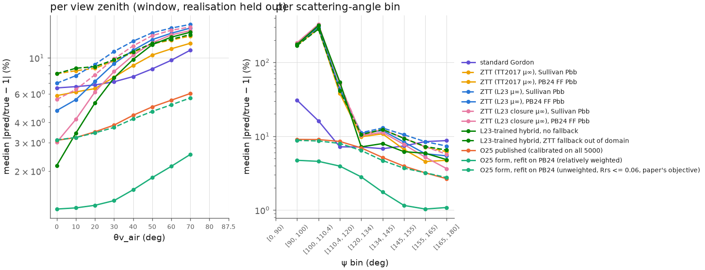
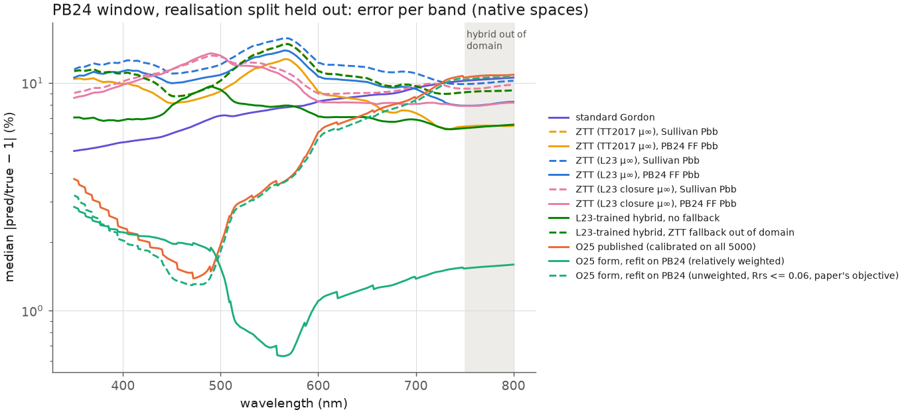
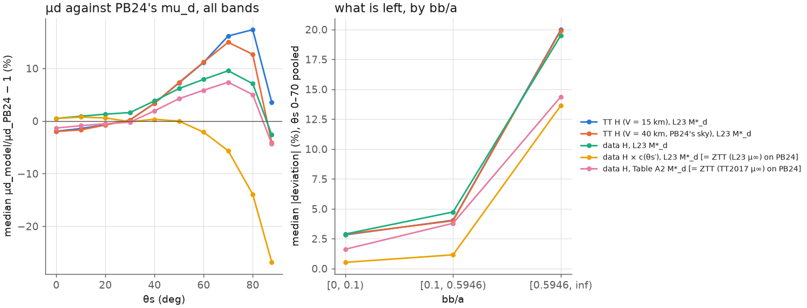
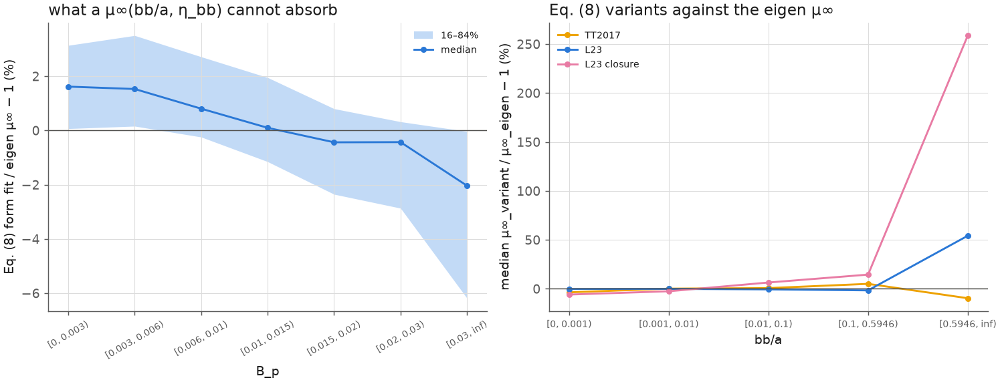
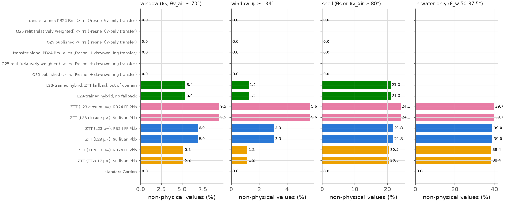

# The elastic models on PB24: the M8 baseline

**Version:** 1.0
**Date:** 2026-11-16
**Authors:** J. Xavier Prochaska and Claude (baseline: Opus 5.5; design
reading: Fable 5.1)
**Status:** short team note. The full tables are in
[`design/ztt_pb24/baseline_report.md`](../design/ztt_pb24/baseline_report.md),
generated from the committed CSVs beside it; every number here is copied
from there. The figures are the committed ones in
[`design/ztt_pb24/`](../design/ztt_pb24/), not regenerated.

**Code:** `design/py/run_pb24_baseline.py` on branch `fit-pb24` (M8 task 6);
record [§7c.6](../design/rt_elastic_implementation.md) and
[§7c.7](../design/rt_elastic_implementation.md).

---

## What was measured

Every elastic model in `robust.rt`, scored on the Pitarch & Brando 2025
HydroLight ensemble (PB24): 5,000 IOP realisations with Fournier–Forand
phase functions spanning B_p 0.0014–0.043, 451 bands 350–800 nm, and
1,300 viewing geometries (10 sun zeniths × 10 view zeniths × 13 azimuths).
A sample is an above-water geometry; `rrs` is read at the Snell-refracted
in-water angle, `Rrs` at the air angle. The sanctioned **window** is
θs ≤ 70° and θv_air ≤ 70° (832 geometries per realisation); the **shell**
(θs or θv_air ≥ 80°) is reported but not fitted. Fits are on the training
side of a saved realisation split (4,000 / 1,000); all numbers below are
held out. The error is `pred/true − 1` per value; medians and q90 are over
every value, and non-physical predictions (≤ 0 or non-finite) are counted,
never dropped. A rerun of the script is byte-identical.

## Headline

Window, realisation split held out, 350–800 nm, 3.75 × 10⁸ values per row.
Gordon, ZTT and the hybrid are scored in `rrs`, O25 in `Rrs`; mapping O25
to `rrs` through the Fresnel transfer adds about 0.5 pp.

| model | median % | q90 % | non-physical % |
|---|---|---|---|
| O25 form, refit on PB24 (relatively weighted) | **1.51** | 5.6 | 0 |
| O25 published (calibrated on all 5,000; in sample) | 4.08 | 18.1 | 0 |
| L23-trained hybrid, no fallback (350–750 nm) | 7.31 | 111 | 5.5 |
| standard Gordon | 7.84 | 21.0 | 0 |
| ZTT (TT2017 µ∞), PB24 FF Pbb | 8.70 | 75 | 5.2 |
| ZTT (L23 closure µ∞), PB24 FF Pbb | 9.17 | 182 | 9.4 |
| ZTT (L23 µ∞), PB24 FF Pbb — the package default | 10.33 | 119 | 6.9 |
| ZTT (TT2017 µ∞), Sullivan Pbb — the M5 model | 10.42 | 73 | 5.2 |

Three readings of this table.

- **O25's form is the standard.** The gap between the published 4.08% and
  our 1.51% is the fitting objective, not the data: the paper's own recipe
  (unweighted, Rrs ≤ 0.06) refit on our training rows scores 3.92%.
- **ZTT is worse than Gordon in the window**, on a dataset whose phase
  functions it is given exactly. Its explicit phase function is worth a
  steady 1–1.7 pp (Sullivan → FF at every µ∞), and its structure holds at
  nadir (4.7% at θv_air = 0, where Gordon is 6.5%), but its error reaches
  15.3% at θv_air = 70°, against 11.2% for Gordon, which has no
  view-angle term at all (Figure 1).
- **The L23-trained hybrid transfers at nadir.** With an emulator that saw
  B_p 0.010–0.018, one sky, nadir and Δφ = 0 only, it scores 2.2% at
  θv_air = 0 across PB24's whole B_p range; its domain check flags 99.6%
  of window samples, so the shipped fallback (to the bare TT2017 backbone)
  makes it worse, 10.6%.



*Figure 1. Median error per above-water view zenith (left) and per in-water
scattering-angle bin (right), window, realisation held out. Every model
degrades with θv_air; ZTT fastest. Below ψ = 110.4°, where its Ψ_KLu changes
sign, ZTT is off by 100–300%.*



*Figure 2. The same cut per band. O25 refit is under 1% at 500–600 nm;
the published O25 degrades to the red because its unweighted objective
favours the blue; the hybrid is out of domain beyond 750 nm by construction
(shaded).*

## Predictions and outcomes

Each diagnostic was written as a prediction with a criterion before the
run (record §7c.6).

| prediction | outcome |
|---|---|
| With the above-water view angle refracted, the window's minimum ψ is ≈ 91° and ZTT's non-physical share falls far below M5's 22% | **Confirmed**: ψ_min = 90.9°; 5.2% of window values (11% of spectra) for the M5 model |
| PB24's own diffuse fraction H removes most of µd's sun-angle trend | **Not confirmed**: the span over θs 0–70° halves (18.1 → 9.1 pp) rather than vanishing; with M7's c(θs′) on top it is 6.4 pp and the window median is 0.5% (Figure 3) |
| What remains in µd is M*_d's extrapolation beyond bb/a = 0.1 | **Confirmed**: 2.9% median at bb/a < 0.1, 19.5% at ≥ 0.59 |
| ZTT's Ψ_KLu/µ∞ is 5–20% above PB24's measured K_Lu/a at nadir | **Not confirmed, worse**: 19–21% high with the L23 or the eigen µ∞ (L23 gave 11–13%), with a 16–84% spread of 1.03–1.68 where TT assume < 2% IOP dependence |
| Substituting the measured K_Lu/a (an oracle) worsens rrs, as on L23 | **Confirmed**: 7.0 → 9.2% at nadir; f_L is calibrated against the wrong Ψ_KLu |
| The asymptotic µ∞ from the eigenproblem varies by several per cent with B_p at fixed (bb/a, η_bb), which Eq. (8) cannot represent | **Confirmed**: 6.2% median span across B_p 0.001–0.036; the Eq. (8) form refit to it leaves a monotone ±2% B_p trend (Figure 4) |



*Figure 3. µd against PB24's tabulated `mu_d`: per sun zenith (left) and
what remains by bb/a (right). The data H removes half the trend; c(θs′)
cancels the rest inside the window and over-corrects beyond 70°.*



*Figure 4. Left: the residual of Eq. (8)'s form, refit to the eigen µ∞ on
PB24, by B_p. Right: the shipped µ∞ variants against the eigen value by
bb/a; the L23 fit is within 1% up to bb/a = 0.1 and clamps beyond 0.59.*



*Figure 5. Share of non-physical predictions per model and cut. The shell
and the in-water-only nodes (beyond the critical angle) are not remote
sensing geometries; ZTT fails on 20–40% of their values.*

## What it means for the backbone (task 7)

- **The error is in the geometry, not on the IOP axis.** ZTT's
  ψ-dependent terms (Ψ_KLu, f_L, the cos θv factor) are the problem; its
  phase-function terms are exact for PB24 and help.
- **Eq. (12) has a second sign-flip mechanism**, found while reading the
  numbers: with TT's f_L above 1, the term (1 − f_L)/b̃b + f_L is negative
  for nearly every PB24 sample, so the denominator crosses zero above a
  finite bb/a that scales with b̃b/(f_L − 1) (bb/a > 0.49 at nadir for
  B_p = 0.005). It explains the non-physical values inside ZTT's own ψ
  domain, the lowest-B_p bin being worst for every variant, and the
  10⁵–10⁶% rRMS. No bounded relative correction repairs a pole, so any
  ZTT-family backbone needs a floor on its denominator before an emulator
  is trained on it.
- **The proposal** (Q21–Q29 of the M8 prompt doc, awaiting decisions):
  a PB24 diffuse-fraction default and a refit c(θs′); a µ∞ with a B_p
  term; a joint Ψ_KLu/f_L refit that is linear in closure space; and, run
  beside it, an O25-form backbone with the backward phase function explicit
  at single-scattering order and parametric geometry. A decision rule is
  written before the fits. The emulator is retrained on whichever survives.

## Reproducibility

```bash
# environment: conda ocean14; data: $OS_COLOR/SD/v5 and the pb24_v1 cache
# run from a plain terminal, in its own scope (memory policy, M8 task 5c)
systemd-run --user --scope -p MemoryMax=80G \
  python design/py/run_pb24_baseline.py            # ~1 h 45 min at 6 workers
python design/py/run_pb24_baseline.py --check      # byte-identical rerun
```

Full run 6,299 s at 6 workers; peak anonymous memory 40 GB. `--check`
reproduced the eigen product, 11 CSVs, the markdown and all five figures
byte for byte. Suite: 865 passed, 5 skipped with the data; 785 passed,
85 skipped without.
